# Digital Image Transmission System Using QPSK and AWGN

**FPT University | Communication Systems | Group 4**

**Scenario:** Wireless Security Camera → Control Room

A Python-based simulation of a digital image transmission system using Quadrature Phase Shift Keying (QPSK) over an attenuated Additive White Gaussian Noise (AWGN) channel.

The project implements a modular communication pipeline, from image encoding and bitstream generation to QPSK modulation, wireless channel simulation, demodulation, image reconstruction, and performance evaluation.

<p align="center">
  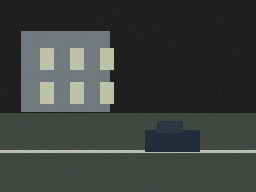
  
</p>

<p align="center">
  <em>Original camera image and grayscale image reconstructed after transmission.</em>
</p>

---

## Table of Contents

- [1. Project Overview](#1-project-overview)
- [2. System Architecture](#2-system-architecture)
- [3. End-to-End Workflow](#3-end-to-end-workflow)
- [4. Image Processing Pipeline](#4-image-processing-pipeline)
- [5. QPSK Modulation and Wireless Channel](#5-qpsk-modulation-and-wireless-channel)
- [6. Receiver and Image Reconstruction](#6-receiver-and-image-reconstruction)
- [7. Performance Evaluation](#7-performance-evaluation)
- [8. Project Structure](#8-project-structure)
- [9. Software Modules](#9-software-modules)
- [10. Installation and Execution](#10-installation-and-execution)
- [11. Command-Line Parameters](#11-command-line-parameters)
- [12. Generated Results](#12-generated-results)
- [13. Model Assumptions and Limitations](#13-model-assumptions-and-limitations)
- [14. Future Improvements](#14-future-improvements)

---

## 1. Project Overview

A wireless security camera must transmit image data to a remote control room through a communication channel. During transmission, attenuation and noise can cause bit errors that affect the integrity of the received payload.

This project models that process using coherent baseband QPSK modulation and an AWGN channel with configurable amplitude attenuation.

The system investigates two image transmission methods:

| Method | Payload format | Main objective |
|---|---|---|
| RAW Grayscale | One byte per grayscale pixel | Reconstruct the image directly from received pixel bytes |
| JPEG Quality 70 | JPEG-compressed RGB image bytes | Investigate the effect of channel errors on compressed-image decoding |

A separate random-bit experiment evaluates simulated BER against the theoretical uncoded QPSK BER.

### Main objectives

- Implement QPSK modulation and coherent hard-decision demodulation.
- Simulate AWGN and configurable amplitude attenuation.
- Compare simulated and theoretical BER across different \(E_b/N_0\) values.
- Transmit raw grayscale and JPEG image payloads.
- Reconstruct a grayscale image from the received payload.
- Evaluate reconstructed-image quality using PSNR.
- Visualize QPSK constellation points and signal-domain characteristics.
- Save experimental results as PNG images and CSV files.

### Technology stack

| Component | Technology |
|---|---|
| Programming language | Python 3.10+ |
| Numerical computation | NumPy |
| Scientific functions | SciPy |
| Image processing | Pillow |
| Visualization | Matplotlib |
| Modulation | Coherent baseband QPSK |
| Channel model | Amplitude attenuation + AWGN |
| Performance metrics | BER and PSNR |
| Output formats | PNG and CSV |

---

## 2. System Architecture

The simulation consists of three primary communication stages: transmitter, wireless channel, and receiver. An evaluation subsystem analyzes the communication performance and reconstructed image.

### 2.1 High-level architecture

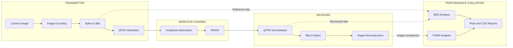

### 2.2 Functional blocks

| Block | Function |
|---|---|
| Image source | Loads the input image and generates supported payload formats |
| Transmitter | Converts payload bytes into bits and maps bit pairs to QPSK symbols |
| Wireless channel | Applies amplitude attenuation and complex Gaussian noise |
| Receiver | Uses hard decisions on the received in-phase and quadrature components |
| Image reconstruction | Converts recovered bytes into an image representation |
| Performance evaluation | Calculates BER and PSNR and records JPEG decoding status |
| Visualization | Generates BER plots, constellation diagrams, and signal plots |

The modular architecture allows individual communication functions to be tested and reused independently.

---

## 3. End-to-End Workflow

The entry point, `main.py`, coordinates the BER experiment, signal visualization, and image-transmission experiment.

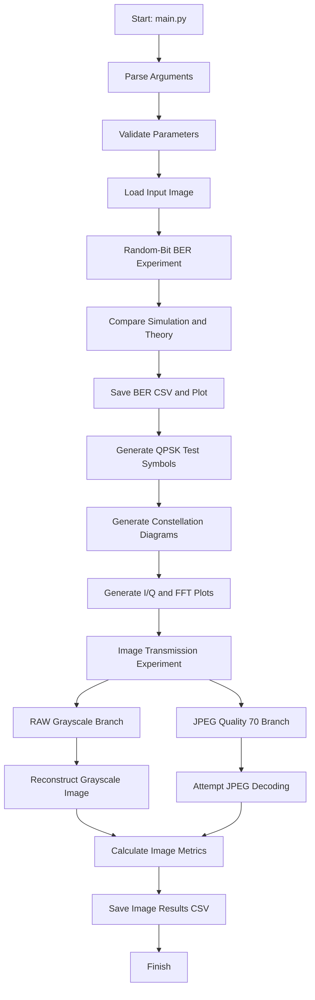

The program performs two distinct experiments.

**Experiment A — Random-bit BER:** Random bits are modulated and transmitted at \(E_b/N_0\) values from \(-2\) dB to \(10\) dB in increments of \(2\) dB. Simulated BER is compared with theoretical uncoded QPSK BER.

**Experiment B — Image transmission:** The same input image is processed using RAW grayscale and JPEG Quality 70 payloads. Both payloads pass through the simulated communication channel and are evaluated independently.

The BER experiment uses a separate random bitstream. Its results should not be confused with the BER measured from either image payload.

---

## 4. Image Processing Pipeline

This section follows the input image through the actual processing stages implemented in `src/image_transmission.py`.

### 4.1 Processing sequence

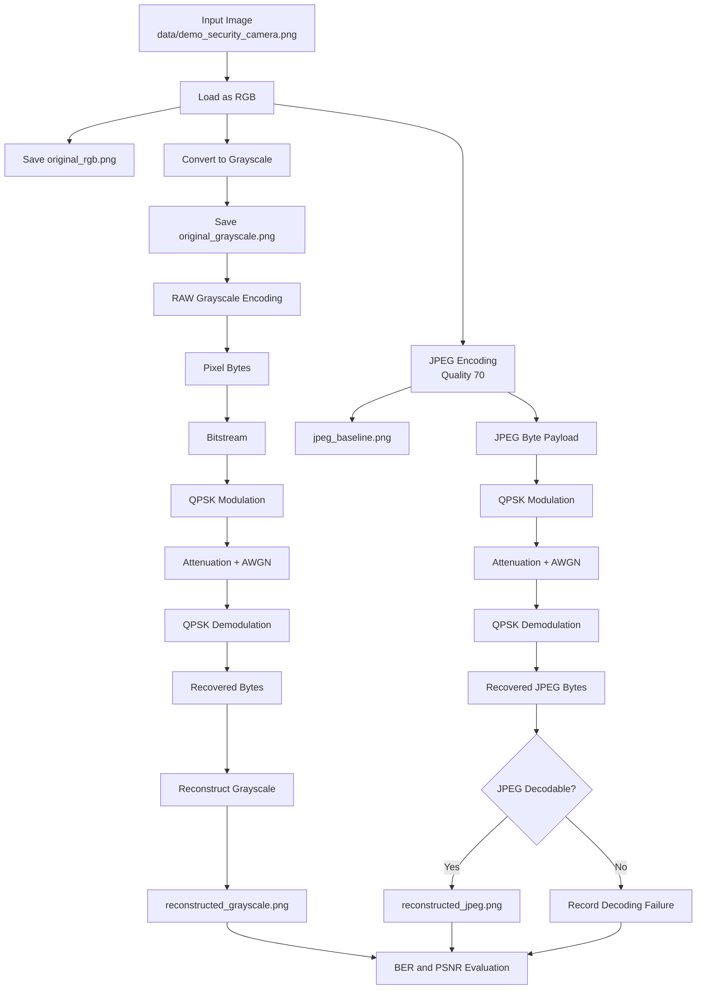

The two branches originate from the same RGB image but use different payload formats.

### 4.2 Stage 1 — Original RGB image

The input image is loaded and converted to RGB using `load_image()`.

The default input is:

`data/demo_security_camera.png`

If the default image does not exist, `create_demo_image()` generates a deterministic synthetic security-camera test image.

**Actual program output:**


`results/original_rgb.png` is the RGB reference image saved by the image-transmission routine.

### 4.3 Stage 2 — Grayscale conversion

The RGB image is converted to grayscale using Pillow's `convert("L")`.

**Actual program output:**

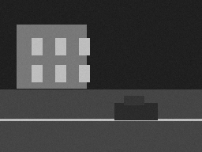

The grayscale image is saved as `results/original_grayscale.png` and is the reference for the RAW grayscale transmission experiment.

For an image of width \(W\) and height \(H\), the raw grayscale payload contains:

\[
N_{\text{bytes}} = W \times H
\]

Each grayscale pixel is represented by one byte.

### 4.4 Stage 3 — JPEG baseline

The RGB image is independently encoded into JPEG format at quality 70.

The resulting JPEG payload is decoded before transmission to create the baseline reference image.

**Actual program output:**

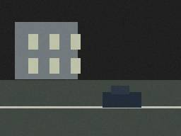

The file `results/jpeg_baseline.png` represents the JPEG encoding result before channel transmission. It provides a reference for the JPEG experiment and is not the reconstructed image received through the channel.

JPEG compression is lossy, so the baseline image may already differ from the original RGB image.

### 4.5 Stage 4 — Convert the payload into bits

The program converts payload bytes into a binary bitstream using `bytes_to_bits()`.

For RAW grayscale, the payload consists of grayscale pixel bytes. For JPEG, the payload consists of the encoded JPEG file bytes.

The resulting bitstream is passed to the QPSK modulator.

### 4.6 Stage 5 — QPSK modulation and signal visualization

The QPSK modulator maps every pair of bits to one complex symbol.

The project uses unit-energy QPSK symbols:

\[
s = \frac{I+jQ}{\sqrt{2}}
\]

where \(I,Q \in \{-1,+1\}\).

The following plots are generated from a separate QPSK test-symbol sequence in `main.py`. They illustrate the signal representation used by the system; they are not direct plots of every symbol belonging to the image payload.

**I/Q symbol sequence:**

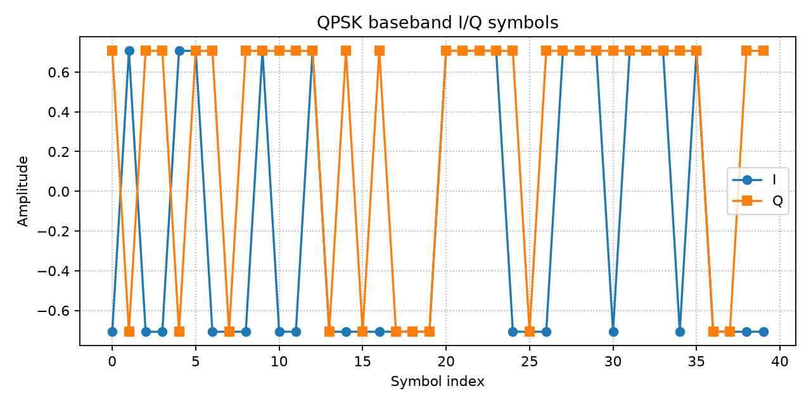

File: `results/qpsk_time_domain.png`

**FFT magnitude:**

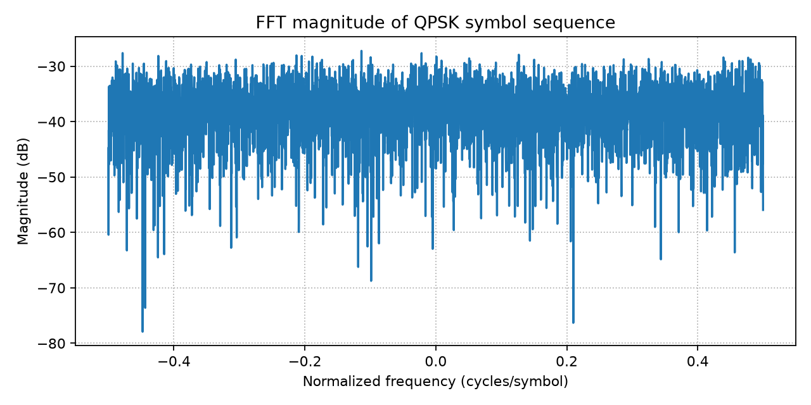

File: `results/qpsk_frequency_domain.png`

The I/Q plot displays the in-phase and quadrature components against symbol index. The FFT plot shows the normalized frequency-domain magnitude of the QPSK symbol sequence.

These are baseband symbol-sequence visualizations, not a complete RF waveform or a pulse-shaped spectrum.

### 4.7 Stage 6 — Wireless channel

The channel applies amplitude attenuation and additive complex Gaussian noise.

The implemented channel model is:

\[
y = ax+n
\]

where:

- \(x\) is the transmitted QPSK symbol.
- \(a\) is the amplitude attenuation factor.
- \(n\) is complex AWGN.
- \(y\) is the received symbol.

The attenuation parameter satisfies:

\[
0<a\leq1
\]

A smaller attenuation factor reduces the received signal amplitude while the noise variance remains referenced to the unit-energy transmitted QPSK signal.

Consequently, attenuation lowers the effective receive SNR.

### 4.8 Stage 7 — Compare QPSK constellation diagrams

**Before the channel:**

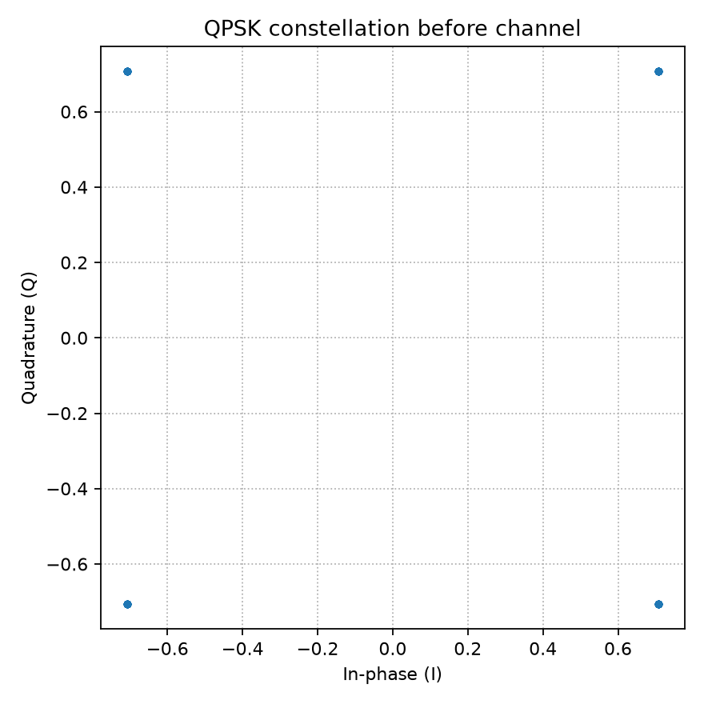

File: `results/constellation_before.png`

The transmitted symbols are concentrated around the four ideal QPSK constellation points.

**After attenuation and AWGN:**

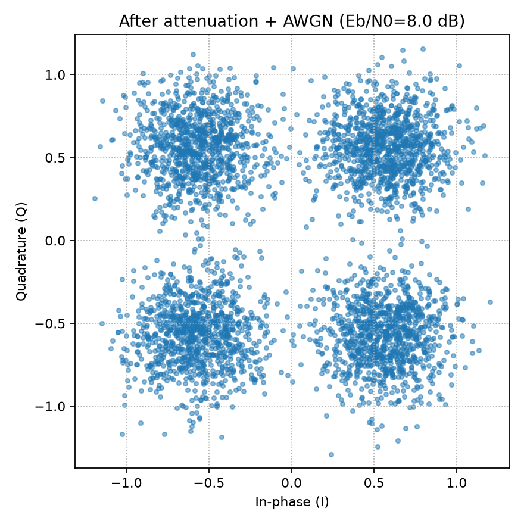

File: `results/constellation_after.png`

Noise spreads the received symbols around their ideal positions, while attenuation scales their amplitudes toward the origin.

The degree of spreading depends on the channel configuration, including \(E_b/N_0\) and the attenuation factor.

### 4.9 Stage 8 — Image reconstruction

For RAW grayscale transmission, the recovered bitstream is converted back to bytes. The receiver then reconstructs a grayscale image using the original width and height.

**Actual program output:**


File: `results/reconstructed_grayscale.png`

The reconstructed image is saved even when some bits are incorrect. Since this is a raw-pixel representation, the received bytes can still be mapped to pixel values.

For JPEG transmission, the receiver attempts to decode the recovered JPEG bytes. If the payload is corrupted and cannot be decoded, the program records a decoding failure instead of saving a misleading output image.

The optional output `results/reconstructed_jpeg.png` is created only when JPEG decoding succeeds.

### 4.10 Image artifact summary

| Processing order | File | Description |
|---:|---|---|
| 1 | `data/demo_security_camera.png` | Default input image |
| 2 | `results/original_rgb.png` | Loaded RGB reference |
| 3 | `results/original_grayscale.png` | Grayscale reference |
| 4 | `results/jpeg_baseline.png` | JPEG quality-70 reference before transmission |
| 5 | `results/constellation_before.png` | Ideal QPSK symbols from the signal-analysis experiment |
| 6 | `results/qpsk_time_domain.png` | QPSK I/Q symbol-sequence visualization |
| 7 | `results/qpsk_frequency_domain.png` | FFT magnitude of the QPSK symbol sequence |
| 8 | `results/constellation_after.png` | Symbols after channel impairment in the signal-analysis experiment |
| 9 | `results/reconstructed_grayscale.png` | Reconstructed grayscale image from the RAW payload |
| 10 | `results/reconstructed_jpeg.png` | Optional reconstructed JPEG image, if decoding succeeds |

The table organizes the outputs by their role in the overall workflow. Some diagnostic plots are generated before the image-transmission routine runs, and the constellation plots use a separate test-symbol sequence rather than the image payload itself.

---

## 5. QPSK Modulation and Wireless Channel

### 5.1 QPSK modulation

Quadrature Phase Shift Keying encodes two bits per symbol. The modulator groups input bits into pairs and maps them to the four complex constellation points.

The implementation uses:

\[
E_s=1,\qquad E_b=\frac{E_s}{2}=\frac{1}{2}
\]

where \(E_s\) is the symbol energy and \(E_b\) is the energy per bit.

### 5.2 AWGN channel

The noise level is configured using \(E_b/N_0\), expressed in decibels.

The program converts it to a linear ratio:

\[
\gamma_b=10^{(E_b/N_0)_{\mathrm{dB}}/10}
\]

The noise spectral-density parameter is:

\[
N_0=\frac{1}{2\gamma_b}
\]

For the unit-energy QPSK symbols, the implementation adds independent Gaussian noise to the real and imaginary components.

The resulting received signal is:

\[
y=ax+n
\]

### 5.3 Theoretical BER

For uncoded coherent QPSK over AWGN, the theoretical bit error rate is:

\[
P_b=\frac{1}{2}\operatorname{erfc}\left(\sqrt{\frac{E_b}{N_0}}\right)
\]

The implementation calculates the theoretical curve using SciPy's complementary error function and compares it with the simulated BER.

The theoretical expression assumes the standard coherent QPSK model without additional amplitude attenuation. In this project, attenuation is applied to the received signal while the noise variance is referenced to the unit-energy transmitted signal. Therefore, the theoretical reference curve is not an attenuation-adjusted prediction of the received BER.

---

## 6. Receiver and Image Reconstruction

The receiver uses coherent hard-decision demodulation.

For each received symbol \(y\), the receiver determines the two output bits from the signs of the in-phase and quadrature components:

\[
\hat b_I =
\begin{cases}
0 & \operatorname{Re}(y)\geq0\\
1 & \operatorname{Re}(y)<0
\end{cases}
\]

\[
\hat b_Q =
\begin{cases}
0 & \operatorname{Im}(y)\geq0\\
1 & \operatorname{Im}(y)<0
\end{cases}
\]

The recovered bits are converted to bytes and interpreted according to the payload format.

### RAW grayscale

The raw grayscale payload can be mapped directly to pixel values. The receiver uses the original image dimensions to reconstruct the grayscale image.

### JPEG Quality 70

The JPEG payload contains compressed image data rather than individual pixel values. Bit errors can corrupt JPEG structures or compressed data and may prevent decoding.

A failed JPEG decode is recorded in the experimental results. It does not mean that the QPSK simulation itself has failed.

---

## 7. Performance Evaluation

The project evaluates communication reliability and image reconstruction quality using BER, PSNR, payload size, and JPEG decoding status.

### 7.1 BER versus \(E_b/N_0\)

The BER experiment evaluates \(E_b/N_0\) from \(-2\) dB to \(10\) dB in increments of \(2\) dB.

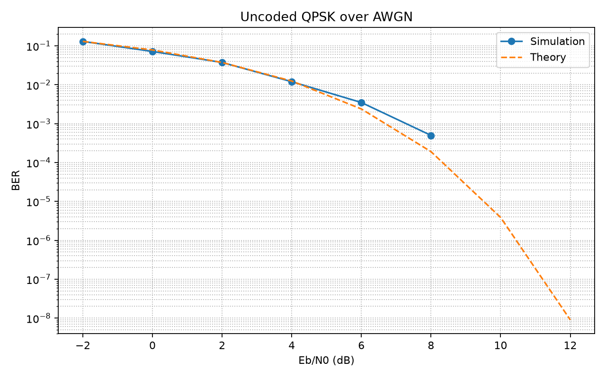

File: `results/ber_vs_ebn0.png`

The plot compares simulated BER with the theoretical uncoded QPSK reference.

In general, increasing \(E_b/N_0\) reduces the probability of a bit error. However, simulated values depend on the finite number of bits used in the experiment. A simulated BER of zero means no errors were observed in that particular sample; it does not prove that the true BER is zero.

### 7.2 Image transmission metrics

The program writes the image experiment results to `results/image_results.csv`.

The CSV includes:

| Field | Meaning |
|---|---|
| `encoding` | Payload encoding method |
| `payload_bytes` | Payload size in bytes |
| `ber` | Fraction of incorrect bits in the transmitted payload |
| `psnr_db` | PSNR of the reconstructed image, when available |
| `decoded` | Whether the image payload was successfully decoded |

### 7.3 Peak Signal-to-Noise Ratio

For the original and reconstructed images, PSNR is calculated from the mean squared error:

\[
\mathrm{MSE}=\frac{1}{N}\sum_{i=1}^{N}(x_i-\hat{x}_i)^2
\]

\[
\mathrm{PSNR}=10\log_{10}\left(\frac{255^2}{\mathrm{MSE}}\right)
\]

where \(x_i\) is an original pixel value and \(\hat{x}_i\) is the corresponding reconstructed pixel value.

A higher PSNR generally indicates a closer pixel-level match.

For RAW grayscale transmission, PSNR compares the original grayscale reference with the reconstructed grayscale image.

For JPEG transmission, PSNR is calculated against the original RGB image only if the received JPEG payload can be decoded successfully. Otherwise, the result is recorded as unavailable.

---

## 8. Project Structure

```text
group4_qpsk_project/
├── data/
│   └── demo_security_camera.png
├── results/
│   ├── ber_results.csv
│   ├── ber_vs_ebn0.png
│   ├── constellation_after.png
│   ├── constellation_before.png
│   ├── image_results.csv
│   ├── jpeg_baseline.png
│   ├── original_grayscale.png
│   ├── original_rgb.png
│   ├── qpsk_frequency_domain.png
│   ├── qpsk_time_domain.png
│   ├── reconstructed_grayscale.png
│   └── reconstructed_jpeg.png  # Optional
├── src/
│   ├── __init__.py
│   ├── channel.py
│   ├── image_source.py
│   ├── image_transmission.py
│   ├── metrics.py
│   ├── qpsk.py
│   ├── receiver.py
│   └── visualization.py
├── .gitignore
├── main.py
├── README.md
└── requirements.txt
```

The optional `reconstructed_jpeg.png` file appears only when the received JPEG payload can be decoded successfully. The `results/` directory is populated when the simulation runs.

---

## 9. Software Modules

| File | Responsibility |
|---|---|
| `main.py` | Entry point, command-line parsing, BER experiment, signal plots, and experiment orchestration |
| `src/image_source.py` | Demo-image generation, image loading, payload encoding, and JPEG decoding |
| `src/qpsk.py` | Byte-to-bit conversion, bit-to-byte conversion, and QPSK modulation |
| `src/channel.py` | Amplitude attenuation and AWGN channel model |
| `src/receiver.py` | Coherent hard-decision QPSK demodulation |
| `src/image_transmission.py` | RAW grayscale and JPEG transmission experiments, image reconstruction, and CSV output |
| `src/metrics.py` | BER, theoretical QPSK BER, and PSNR calculations |
| `src/visualization.py` | BER plot, constellation diagrams, I/Q plot, and FFT plot |
| `requirements.txt` | Python package dependencies |

### Module interaction

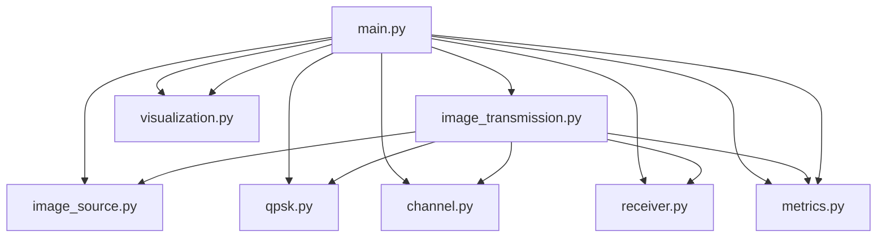

The modules have separate responsibilities, while `main.py` coordinates the complete experiment.

---

## 10. Installation and Execution

### 10.1 Requirements

- Python 3.10 or later
- `pip`
- A terminal on Linux, macOS, or Windows

### 10.2 Ubuntu / Linux

Clone the repository and enter the project directory:

```bash
git clone https://github.com/BlackWater006/Wireless-Security-Camera-qpsk-conmmunication.git
cd Wireless-Security-Camera-qpsk-conmmunication
```

Create and activate a virtual environment:

```bash
python3 -m venv .venv
source .venv/bin/activate
```

Install dependencies:

```bash
python -m pip install --upgrade pip
python -m pip install -r requirements.txt
```

Run the simulation:

```bash
python main.py
```

### 10.3 Windows PowerShell

```powershell
git clone https://github.com/BlackWater006/Wireless-Security-Camera-qpsk-conmmunication.git
cd Wireless-Security-Camera-qpsk-conmmunication

py -m venv .venv
.\.venv\Scripts\Activate.ps1

python -m pip install --upgrade pip
python -m pip install -r requirements.txt

python main.py
```

### 10.4 Use a custom camera image

```bash
python main.py --image data/security_camera.jpg
```

The supplied image must exist at the specified path and be readable by Pillow.

### 10.5 Verify the results

After execution, inspect the generated files:

```bash
find results -maxdepth 1 -type f -printf '%f\n' | sort
```

View the plots and images using your preferred image viewer, or open the PNG files directly from the `results/` directory.

---

## 11. Command-Line Parameters

| Parameter | Default | Description |
|---|---:|---|
| `--image` | Default demo image | Optional path to a custom PNG/JPEG image |
| `--ebn0` | `8.0` | \(E_b/N_0\) in dB for the image-transmission and signal-constellation experiments |
| `--attenuation` | `0.8` | Amplitude attenuation factor, constrained to \(0<a\leq1\) |
| `--ber-bits` | `200000` | Number of random bits in the BER experiment; minimum is 100 |
| `--seed` | `7` | Random seed for reproducible experiments |

### Example: default configuration

```bash
python main.py
```

### Example: stronger attenuation

```bash
python main.py --ebn0 8 --attenuation 0.5
```

### Example: compare channel noise levels

```bash
python main.py --ebn0 0 --attenuation 0.8
python main.py --ebn0 4 --attenuation 0.8
python main.py --ebn0 10 --attenuation 0.8
```

### Example: increase BER experiment size

```bash
python main.py --ber-bits 200000 --seed 7
```

The `--ebn0` parameter controls the image-transmission channel and the channel-impaired constellation experiment. The BER experiment independently sweeps its predefined \(E_b/N_0\) values.

**Important:** Each run overwrites files with matching names in `results/`. If bro wants to preserve results from different configurations, copy the output directory before running the next experiment.

---

## 12. Generated Results

The program saves its output under `results/`.

### 12.1 Communication performance

| File | Description |
|---|---|
| `ber_results.csv` | Simulated and theoretical BER values |
| `ber_vs_ebn0.png` | BER comparison plot |
| `constellation_before.png` | QPSK constellation before channel impairment |
| `constellation_after.png` | QPSK constellation after attenuation and AWGN |
| `qpsk_time_domain.png` | In-phase and quadrature symbol values |
| `qpsk_frequency_domain.png` | FFT magnitude of the QPSK symbol sequence |

### 12.2 Image-processing outputs

| File | Description |
|---|---|
| `original_rgb.png` | Original RGB image reference |
| `original_grayscale.png` | Grayscale image before transmission |
| `jpeg_baseline.png` | JPEG quality-70 reference before transmission |
| `reconstructed_grayscale.png` | Grayscale image reconstructed from the received RAW payload |
| `reconstructed_jpeg.png` | Optional JPEG reconstruction, available only when decoding succeeds |
| `image_results.csv` | Payload size, BER, PSNR, and decoding status for both image formats |

These files provide visual and numerical evidence of the simulation's behavior under different channel configurations.

---

## 13. Model Assumptions and Limitations

The current implementation uses the following assumptions:

- Uncoded coherent baseband QPSK.
- Ideal carrier and timing synchronization.
- Unit-energy transmitted QPSK symbols.
- Two bits per QPSK symbol, with \(E_b=E_s/2\).
- Channel model \(y=ax+n\), with amplitude attenuation \(a\) and complex AWGN \(n\).
- Noise variance referenced to the unit-energy transmitted signal.
- Hard-decision receiver without channel decoding or error correction.
- Random-bit BER testing is separate from the image-payload experiments.
- JPEG quality 70 is applied before transmission.
- JPEG payload decoding may fail if channel errors corrupt the compressed data.

This is a baseband simulation rather than a complete radio-frequency system. It does not currently model:

- RF carrier upconversion and downconversion.
- Pulse shaping and matched filtering.
- Multipath fading.
- Synchronization errors.
- Packet framing and retransmission.
- Forward error correction.
- Adaptive modulation and coding.

The simulation is intended to demonstrate core digital communication principles and the effect of channel impairments on image payloads.

---

## 14. Future Improvements

Potential extensions include:

- Add Gray-coded QPSK mapping and explicit mapping tests.
- Implement pulse shaping and matched filtering.
- Add multipath fading channel models.
- Implement packet framing, checksums, and retransmission.
- Add forward error correction and compare BER before and after decoding.
- Evaluate additional image compression formats and quality settings.
- Add SSIM or other image-quality metrics.
- Automate experiments across multiple attenuation and \(E_b/N_0\) configurations.
- Export experiment configurations and metadata alongside result CSV files.

---

## Author and Project Context

**Course:** Communication Systems — Hệ thống Truyền thông  
**Institution:** FPT University  
**Assignment:** Group 4  
**Scenario:** Wireless Security Camera → Control Room

The project demonstrates a modular QPSK image-transmission simulation, combining digital modulation, channel modeling, image reconstruction, and communication-performance analysis.
